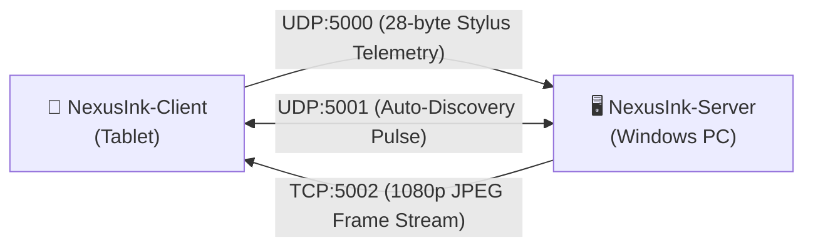

# 🎨 NexusInk-Client

<p align="center">
  
  <a href="https://github.com/brandalexdev/NexusInk-client/releases/latest">
    
  </a>
</p>

<p align="center">
  <a href="https://github.com/brandalexdev/NexusInk-client/releases/latest"></a>
  <a href="https://github.com/brandalexdev/NexusInk-Server"></a>
  <a href="#"></a>
  <a href="#"></a>
  <a href="#"></a>
</p>

---

## 📖 Overview

**NexusInk-Client** is a high-precision, low-latency graphic tablet client built for Android and HarmonyOS tablets with active styluses. It transforms your tablet into a professional **Wacom Cintiq / Intuos** style drawing display for Windows PCs.

Paired with the [**NexusInk-Server**](https://github.com/brandalexdev/NexusInk-Server) Windows application, your tablet sends native pressure, tilt, hover, and shortcut events directly into the Windows Ink API while receiving a real-time **1080p Full HD screen stream**.

> [!NOTE]
> This repository contains the **tablet client** application (APK). For the Windows desktop host application, check out [**NexusInk-Server**](https://github.com/brandalexdev/NexusInk-Server).

---

## 📥 Direct Download & Quick Start (For Regular Users)

> [!IMPORTANT]
> **No compilation or coding required!**  
> You do **not** need to install Flutter, Android SDK, or build anything. Simply download the pre-compiled `.apk` file directly to your tablet and start drawing in seconds.

👉 [**Click Here to Download Latest NexusInk-Client.apk (GitHub Releases)**](https://github.com/brandalexdev/NexusInk-client/releases/latest)

### 📲 How to Start in 3 Steps:

1. **Download the APK:**  
   Open the [Releases page](https://github.com/brandalexdev/NexusInk-client/releases/latest) from your tablet browser and download **`NexusInk-Client.apk`** (or download it to your PC and transfer it via USB cable or LocalSend).

2. **Install on Your Tablet:**  
   Tap the downloaded `.apk` file to install it. If prompted by your system, enable *"Install unknown apps"*.

3. **Open Server & Draw:**  
   * On your Windows PC, double-click [**`NexusInk-Server.exe`**](https://github.com/brandalexdev/NexusInk-Server).
   * Open **NexusInk-Client** on your tablet. Both devices will automatically detect and pair with each other in less than 1 second via UDP auto-discovery!

> [!TIP]
> **Wired USB Connection (< 1ms Latency):** Connect your tablet to the PC via USB-C cable and enable **USB Tethering** in tablet network settings. Windows will detect a direct network link; tap *Auto-Discover* on the tablet to connect instantly with sub-millisecond response.

> [!TIP]
> **HarmonyOS / EMUI Tip:** Go to *Settings ➔ Accessibility features ➔ Stylus (M-Pencil)* and turn off **"FreeScript"** so the OS does not intercept fast strokes near screen borders.

---

## ✨ Key Features

* **🖼️ 100% True Edge-to-Edge Canvas:** Utilizes every physical pixel of your tablet screen ($2200 \times 1440$ on MatePad 11.5, $2560 \times 1600$ on Galaxy Tab) with zero system bars, cutoffs, or margins.
* **⚡ Zero-Latency Local Ink Trail:** Renders dynamic pressure rings and instant visual ink feedback at up to **120Hz** while UDP packets are simultaneously transmitted to the PC.
* **🛡️ Hardware-Level Palm Rejection:** Filters events strictly by hardware pointer kind (`PointerDeviceKind.stylus` and `PointerDeviceKind.invertedStylus`). Rest your palm comfortably on the glass without false triggers.
* **🖥️ Dual Mode (Cintiq vs Intuos):**
  * **Cintiq Mode:** Live 1080p PC monitor streaming directly on your tablet display.
  * **Intuos Mode:** Screen stream off, displaying a sleek dark grid for ultra-long battery life.
* **📐 Aspect Ratio Toggle:** Switch between **100% Full-Screen Stretch** (fills the entire tablet aspect ratio) and **16:9 Aspect Lock** (preserves perfect geometry and circles).
* **🎛️ Flush 38px Frosted-Glass Dock:** Pinned to the left bezel (`x = 0`) with quick-access creative hotkeys (`Ctrl+Z`, `Ctrl+Shift+Z`, `Space`, `Alt`, `B`, `E`). Can be collapsed with a single tap to an ultra-compact $32\text{px}$ arrow.
* **🔄 Zero-Config Auto-Discovery:** Sends UDP broadcast pulses on port `5001` to automatically detect and pair with your PC without typing manual IP addresses.

---

## 🛰️ Architecture & Network Protocol

NexusInk uses dedicated, decoupled network channels to ensure maximum responsiveness:



| Channel | Protocol | Port | Description |
| :--- | :---: | :---: | :--- |
| **Stylus Telemetry** | UDP | `5000` | Compact 28-byte binary packets ($X, Y$, pressure $0.0-1.0$, tilt, orientation, eraser) and 4-byte shortcut triggers. |
| **Auto-Discovery** | UDP | `5001` | Broadcast discovery pulse (`DISCOVER_NEXUS_SERVER`) to pair devices automatically in < 1 second. |
| **Screen Streaming** | TCP | `5002` | High-efficiency 1080p JPEG video stream with adaptive quality. |

---

## 🎛️ Left Dock Controls Reference

The collapsible frosted-glass dock provides instant access to essential drawing shortcuts:

| Icon | Function | Windows Action | Application Behavior |
| :---: | :--- | :--- | :--- |
| **`<` / `>`** | **Collapse / Expand Dock** | UI Toggle | Minimizes the dock to a single $32\text{px}$ indicator. Green = Connected, Amber = Searching. |
| **↶** | **Undo** | `Ctrl + Z` | Reverts the last stroke. |
| **↷** | **Redo** | `Ctrl + Shift + Z` | Restores the previously undone action. |
| **✋** | **Pan Canvas** | `Space` | Activates canvas drag/pan in Photoshop, Krita, or Clip Studio Paint. |
| **💉** | **Eyedropper** | `Alt` | Samples color under the stylus tip. |
| **🖌️ / 🧹** | **Brush / Eraser** | `B` / `E` | Toggles between drawing brush and eraser mode. |
| **🔲** | **Fit vs Stretch** | Toggle | Switches between 100% full-screen stretch and locked 16:9 proportion. |
| **👁️** | **Display Stream** | Toggle | Switches between Cintiq Mode (live monitor view) and Intuos Mode (battery-saving dark grid). |
| **🎚️** | **Settings & Manual IP** | Modal | Allows manual IP entry and adjusts pressure curve sensitivity ($0.5\times - 2.0\times$). |

---

## 📱 Hardware & Stylus Compatibility

Because NexusInk reads native hardware stylus axes directly from the OS, it works with any active digitizer stylus:

| Tablet Line | Compatible Models (Examples) | Active Stylus | Capabilities |
| :--- | :--- | :--- | :---: |
| **Huawei** | • MatePad 11.5 (2025 / 2023) & 11.5" S PaperMatte<br>• MatePad Pro 11 / 12.2 / 13.2<br>• MatePad Air & MatePad 11 (120Hz)<br>• MatePad SE *(with active pen)* | **Huawei M-Pencil**<br>*(2nd & 3rd Gen NearLink)* | 4096–16384 Pressure Levels, Tilt, Hover & Barrel Button |
| **Samsung** | • Galaxy Tab S10 / S9 / S8 / S7 (Standard, `+`, `FE`, `Ultra`)<br>• Galaxy Tab S6 Lite | **S-Pen**<br>*(Wacom EMR)* | Full Pressure, Tilt, Hover & Side Button |
| **Xiaomi / Redmi** | • Xiaomi Pad 7 / Pad 6 / Pad 6S Pro / Pad 5<br>• Redmi Pad Pro | **Xiaomi Smart Pen**<br>*(1st & 2nd Gen / Focus Pen)* | Full Pressure, Tilt & Shortcut Buttons |
| **Lenovo** | • Tab P11 Pro / Tab P12 / Tab Extreme<br>• Legion Tab Y700 | **Lenovo Precision Pen**<br>*(Pen 2 / 3 & Tab Pen Plus)* | Full Pressure & Tilt |
| **Honor** | • Honor Pad 9 / MagicPad 2 / Pad V8 Pro | **Honor Magic-Pencil 3** | Full Pressure, Tilt & Hover |
| **OnePlus / Oppo** | • OnePlus Pad / Pad 2 & Oppo Pad 2 / 3 | **OnePlus Stylo 1 / 2** | Full Pressure & Tilt |

---

## 🛠️ For Developers: Building from Source (Optional)

<details>
<summary><b>Click here if you are a developer and wish to compile or modify the source code with Flutter</b></summary>
<br>

> [!NOTE]
> This section is strictly for developers who want to contribute or customize the app. Regular users should follow the [Direct Download](#-direct-download--quick-start-for-regular-users) instructions above.

### Prerequisites
* Flutter SDK (3.13+ or latest 3.47+)
* Android SDK (API 34+)
* Java / JDK 17

### Build Commands:
```bash
# 1. Clone the repository
git clone https://github.com/brandalexdev/NexusInk-client.git
cd NexusInk-client

# 2. Get dependencies
flutter pub get

# 3. Build release APK
flutter build apk --release
```

The resulting package is generated at:
`build/app/outputs/flutter-apk/app-release.apk`

</details>

---

## 🔗 Related Projects

* [**NexusInk-Server**](https://github.com/brandalexdev/NexusInk-Server): The companion Windows desktop application providing native Windows Ink digitizer injection and 1080p screen streaming.

---

## 📄 License

This project is licensed under the MIT License - see the [LICENSE](LICENSE) file for details.